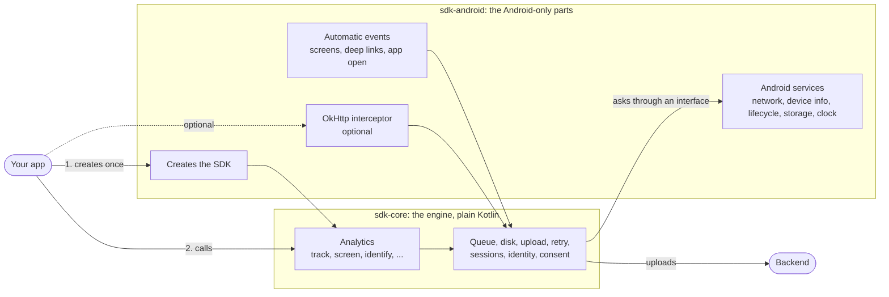
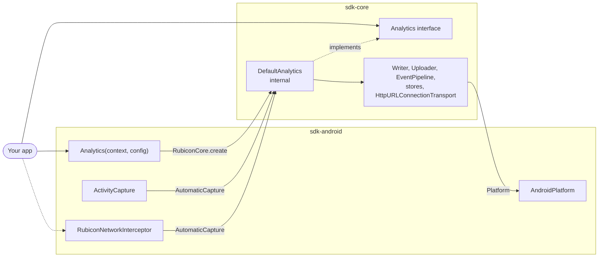
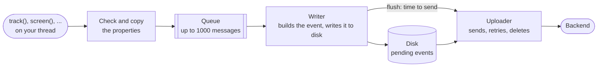
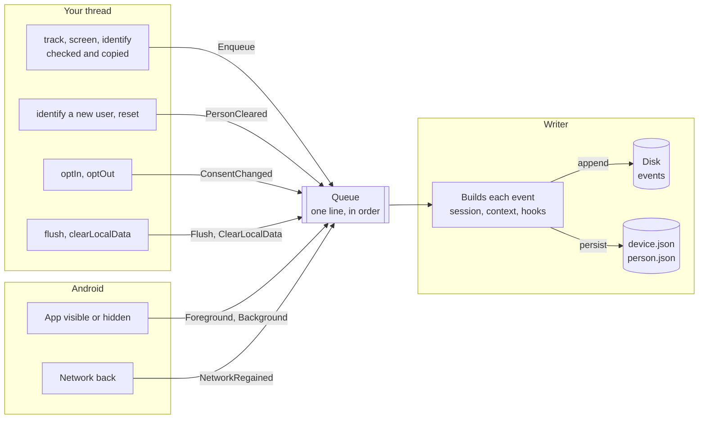
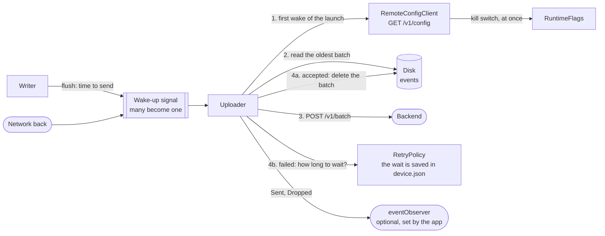
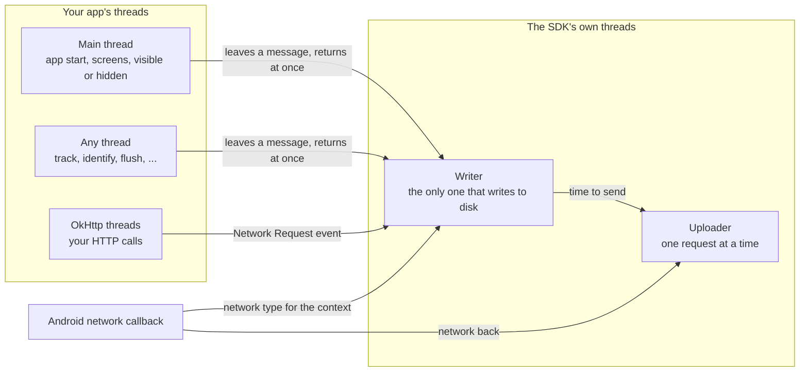

# 1. Architecture

[Index](README.md) · Next: [2. The journey of an event](02-event-journey.md)

## 1.1 Modules and the platform boundary

Your app talks to two things: the factory once, and `Analytics` for every call. Everything else is
inside (Configuration 5, Public API 1, 2 and 6).

### 1.1a The big picture

- The app adds one dependency, `sdk-android`, which brings `sdk-core`.
- `sdk-core` has no Android code. When it needs the platform it asks the `Platform` interface, which
  `sdk-android` implements, and tests replace with a fake.

### 1.1b The same, with class names

| `Platform` part | Provided on Android by |
|---|---|
| Network state | `AndroidNetworkMonitor` |
| Device, screen, locale, network type | `AndroidContextProvider` |
| Foreground and background | `AndroidLifecycleSource` |
| Main process, app version | `AndroidProcessInfo` |
| Logs | `LogcatLogger` |
| Time since boot, for sessions and retry waits | `SystemClock.elapsedRealtime()` |
| Files | `FileEventStore` and `FileKeyValueStore` in `noBackupFilesDir/rubicon` |
| Wall clock, random, dispatchers, HTTP | The shared JVM implementations of `sdk-core` |

| Rule | Where it is decided |
|---|---|
| One dependency for apps: `sdk-android` brings `sdk-core` | Public API 6 |
| OkHttp and androidx.activity are `compileOnly`, behind class presence checks | Configuration 5, D13 |
| Uploads use `HttpURLConnection`, never the app's OkHttp | HTTP 1 |
| Everything `internal` unless it must be public; cross-module use is `@RubiconInternal` | Public API 2 |

## 1.2 Runtime components

### 1.2a The big picture

A call never waits for the disk or the network: it leaves a message in a queue and returns. Two
workers do the rest, one after the other (Queue 1, Public API 9).

| Station | Does | Never does |
|---|---|---|
| Your thread | Checks names and values, copies the map, notes who the user is | Disk or network work |
| Writer | Sessions, context, `beforeSend` hooks, writing to disk, deciding when to flush | Network work |
| Uploader | Reads a batch, sends it, deletes it after the server accepts it, waits after a failure | Building events |

### 1.2b What goes into the writer

Besides events, the queue carries control messages, so they keep their order with the events:
`track()` and then `optOut()` always apply in that order.

| Message | What the writer does |
|---|---|
| `Enqueue` | Runs the event through the pipeline and appends it |
| `PersonCleared` | Ends the session as the previous user |
| `ConsentChanged` | Ends the session on an opt-out; flushes when consent arrives after `PENDING` |
| `Flush` | Closes the open segment and wakes the uploader |
| `ClearLocalData` | Deletes every queued event and ends the session, without an event |
| `Foreground`, `Background` | `Application Opened` or `Backgrounded`, session start or countdown, a flush on background |
| `NetworkRegained` | A flush, when events are waiting |

A full queue drops the new event and counts it (`backpressure`); the caller never waits. The JSON
files are written when the writer is idle, or every 100 messages under load.

### 1.2c Around the uploader

| Part | What it is |
|---|---|
| Wake-up signal | Conflated: ten signals in a row wake the uploader once |
| `RetryPolicy` | Decides, after each failure, how long to wait (see 3.4) |
| `RemoteConfigClient` | Fetches the remote settings once per launch (see 5.6) |
| `RuntimeFlags` | The two remote switches that apply at once: the kill switch and network request capture |
| `eventObserver` | Optional callback the app sets to follow each event: `Queued` from the writer, `Sent` and `Dropped` from both |

## 1.3 Threads

Your app's threads never wait for the SDK. They leave a message and return; the SDK does the slow
work on two threads of its own, one task at a time each (Queue 1, Public API 9).

| Your thread | Writer | Uploader |
|---|---|---|
| Checks names and values, copies the map | Loads the files at start, then handles messages in order | Fetches remote settings, once per launch |
| Notes the user and super properties at that moment | Sessions, context, hooks, the second check | Sends batches, oldest first, one at a time |
| Takes screen, locale and network values from a cache | Writes events and the JSON files, decides when to flush | Waits after a failure, deletes after the server accepts |
| `isOptedOut()` and `deviceId` may read `device.json` once, very early | `SDK Diagnostics` | `Sent` and `Dropped` updates |

| In code | |
|---|---|
| Writer and uploader | Coroutines on `Dispatchers.IO.limitedParallelism(1)`, in the SDK's own `CoroutineScope` |
| Leaving a message | `Channel.trySend`, which never suspends or blocks |
| A request that hangs | A watchdog disconnects it after 45 seconds, so the uploader never sticks |
