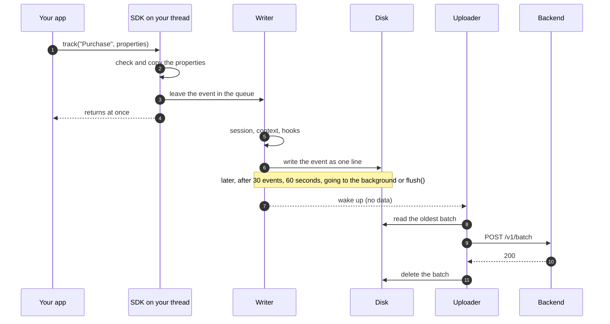
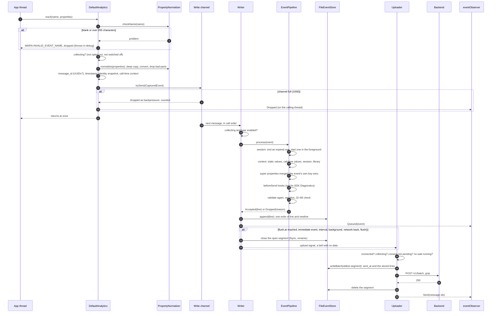
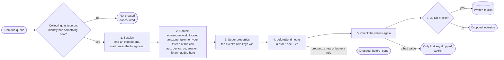
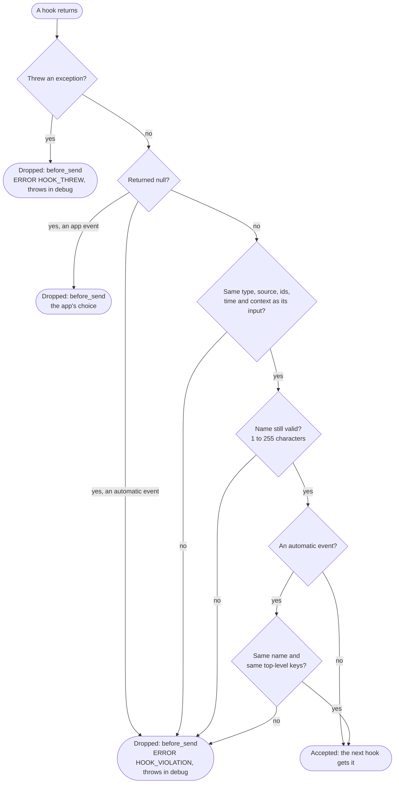
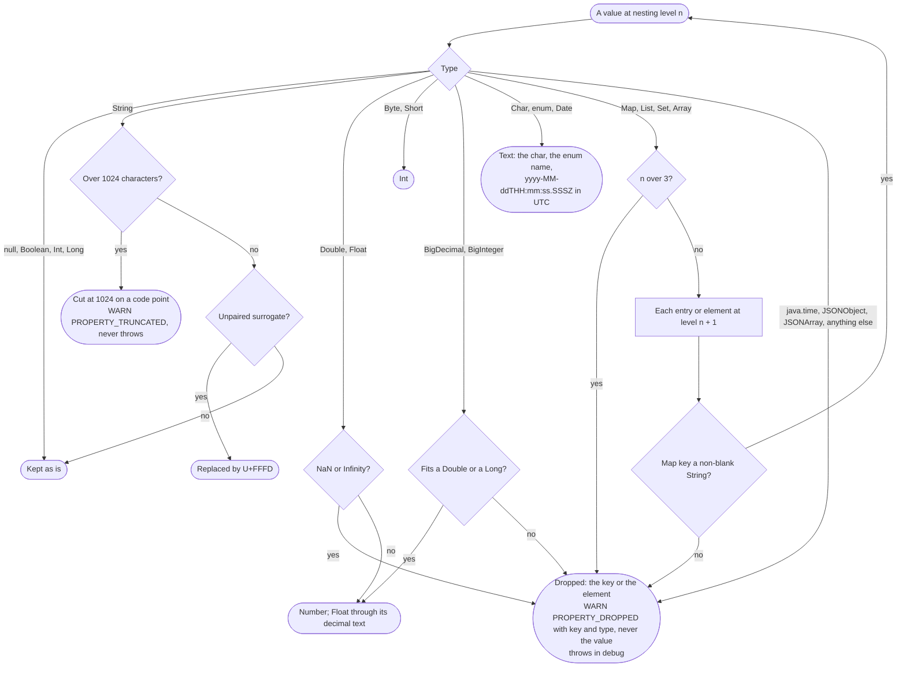
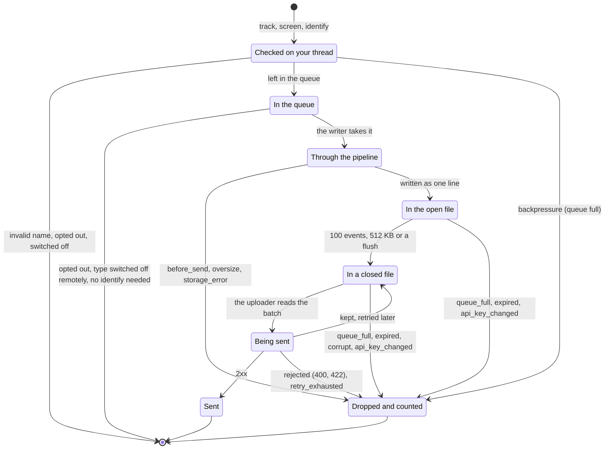

# 2. The journey of an event

[Index](README.md) · Previous: [1. Architecture](01-architecture.md) · Next: [3. Queue, storage and upload](03-queue-and-upload.md)

## 2.1 From `track()` to the server

One event, from the app's call to its deletion after the server accepted it. `screen` takes the
same path; `identify` goes through `Identity` first (see 4.2).

### 2.1a The big picture

- Step 7 is a bell, not a hand-over: the uploader takes the batches from disk itself, all of them,
  oldest first, including any left from earlier runs.
- Between steps 3 and 6 the event is only in the in-memory queue. If the process is killed in that
  window, usually a few milliseconds, the event is lost. From step 6 on it survives a crash or a
  kill and stays on disk until the server accepts it.

### 2.1b The same, in detail

`eventObserver` is optional and is called on the SDK's threads (the writer or the uploader, or the
calling thread for a backpressure drop), never posted to the main thread: an observer that updates
the UI must switch threads itself.

## 2.2 Inside the pipeline

`EventPipeline.process` on the writer: the steps every event goes through, in order, and where it
can be dropped.

### 2.2a The steps

`SDK Diagnostics` skips step 4; `Session Started` and `Session Ended` are created in step 1 and go
through the same steps.

### 2.2b The rules for a hook

Each hook gets the event and returns it, a changed copy or `null`. The SDK checks the result before
the next hook runs (Public API 4).

| Event source | What a hook may do |
|---|---|
| `APP` (the app's calls) | Any valid name, any keys and values, or `null` to drop it |
| `AUTO` (the SDK's own) | Change values only (also to `null` or another type); same name, same top-level keys, never `null` |
| `SDK Diagnostics` | Never reaches a hook |

## 2.3 Validating a property value

`PropertyNormalizer`, on the calling thread for the app's maps, and again after the hooks. A bad
key or value drops only itself; the event is kept (Public API 3, Serialization 2 and 3).

| Kept as is | Converted | Dropped, with a WARN (throws in debug) |
|---|---|---|
| `null`, `Boolean`, `Int`, `Long` | `Float`, `Double` to a number (`Float` through its decimal text) | NaN, Infinity |
| `String` up to 1024 characters | A longer `String` cut at 1024 on a code point (WARN, never throws) | `java.time` types |
| `List` and `Map` of allowed values, 3 levels deep | An unpaired surrogate to U+FFFD | `JSONObject`, `JSONArray` |
| | `Byte`, `Short` to `Int` | A map key that is blank or not a `String` |
| | `BigDecimal` to `Double`, `BigInteger` to `Long`, when they fit | `BigDecimal`, `BigInteger` that do not fit |
| | `Char` and `enum` to text, `Date` to ISO 8601 in UTC | Nesting deeper than 3 |
| | Arrays, `Set` and other collections to a list | Anything else |

The tree below is the same, decision by decision:

Nesting: a property may hold up to three maps or lists inside each other. `{"a": {"b": {"c": {"d": 1}}}}`
(three maps under the property `a`) is kept; one more, `{"a": {"b": {"c": {"d": {"e": 1}}}}}`,
drops only `d` with a WARN and keeps the rest.

After the values: more than 256 properties, super properties included, drops the extra ones,
super properties first (`TOO_MANY_PROPERTIES`).

## 2.4 The states of an event

Where an event can be, and every way it can end. Each drop is counted under its reason and reported
by `SDK Diagnostics` (Queue 5, Logging 5).

`clearLocalData()` and an opt-out from `PENDING` delete waiting events on purpose: they are not
counted as drops (Privacy 3 and 4).
