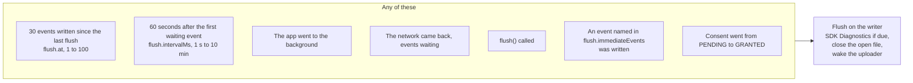
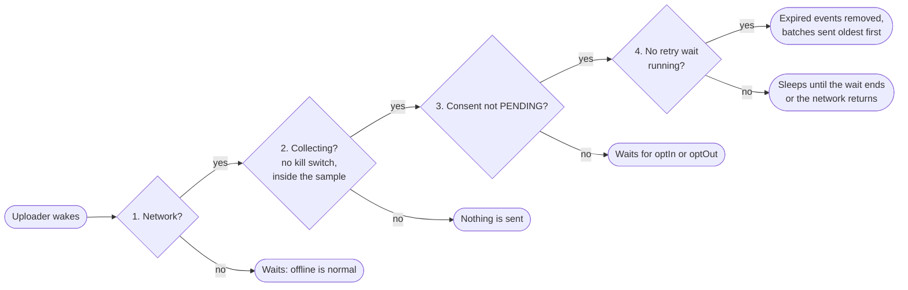
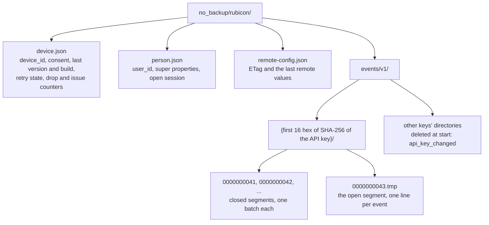
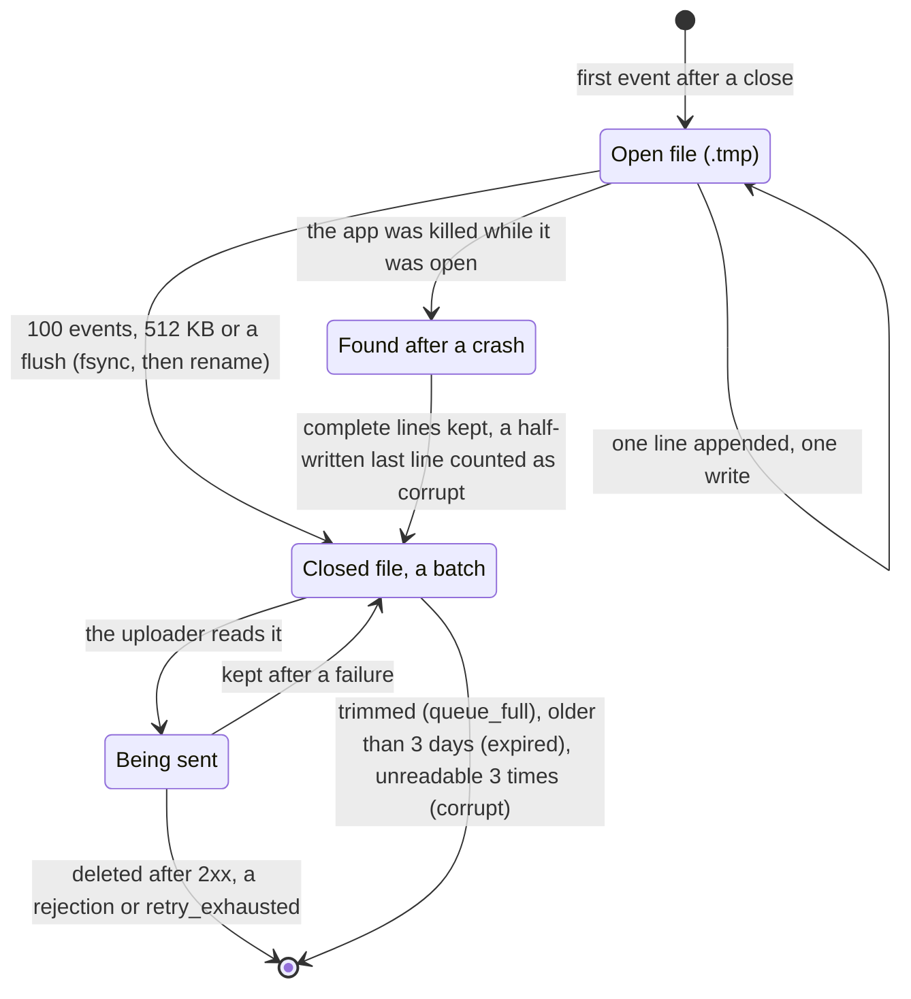
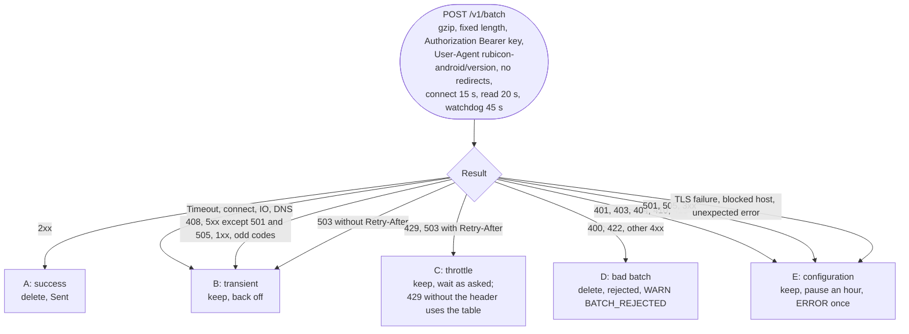
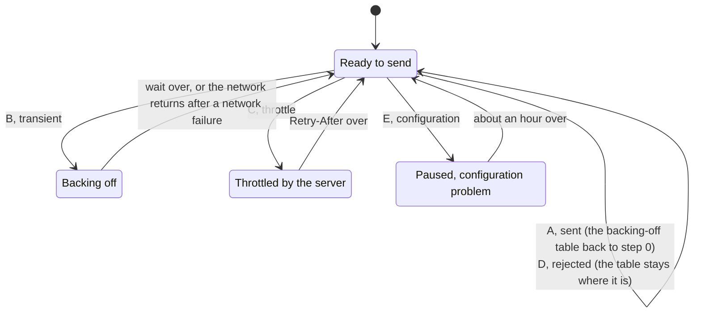
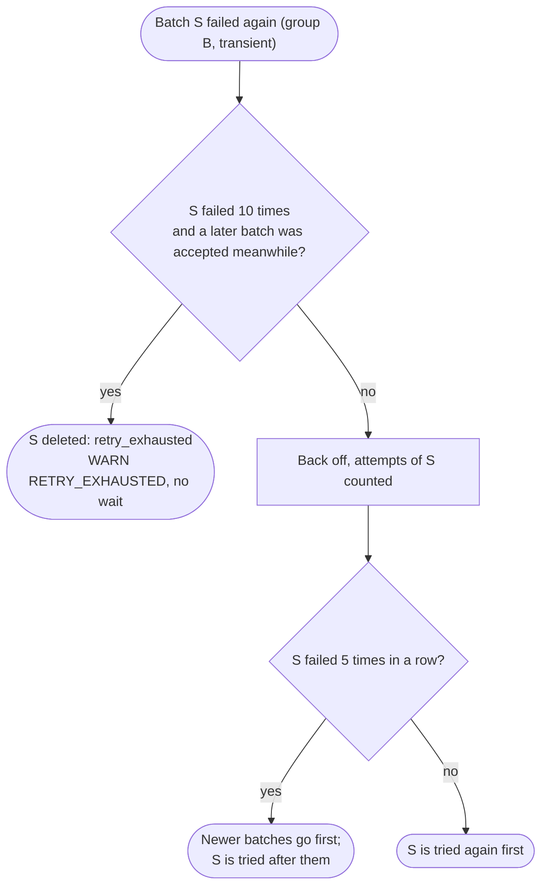

# 3. Queue, storage and upload

[Index](README.md) · Previous: [2. The journey of an event](02-event-journey.md) · Next: [4. Identity, sessions and privacy](04-identity-session-privacy.md)

## 3.1 Flushing

A flush closes the file events are being written to and wakes the uploader. There is no flush at
startup and no periodic timer (Queue 2, 3, 6, 7).

### 3.1a When a flush happens

The 60 seconds is a one-shot timer, not a clock that ticks: the first event written after a flush
starts it, every flush cancels it, and it counts from the first waiting event, not the last. When it
fires it puts a `Flush` message into the write queue, so it keeps its order with the events.

| Time | What happens | Timer |
|---|---|---|
| 0 s | Event A written | Started, fires at 60 s |
| 20 s | Event B written | Already running, not extended |
| 60 s | Fires: `Flush` into the queue, the file closes, the uploader wakes | Gone |
| 5 min | No events | None: nothing runs while idle |
| 5 min 10 s | Event C written | Started, fires at 6 min 10 s |

The timer also starts at launch when events were left from the last run. If the process is killed,
the timer is gone but the events stay on disk for the next launch.

### 3.1b What the uploader checks before sending

After an opt-out, events queued with consent are still sent: only `PENDING` closes gate 3
(Privacy 1, 4).

## 3.2 Files on the device

Everything lives under `noBackupFilesDir/rubicon/`: excluded from backup, so a `device_id` is never
cloned to another phone, and removed with the app's data (Disk 1 to 7, Identity 1).

A segment is a numbered file of events, one JSON line each. Events are added to the open segment;
once closed it never changes again and is sent as one batch, like a rolling log file.

| Limit | Value | When it is exceeded |
|---|---|---|
| Pending events | 1000 | The oldest go, down to 900 in one step: `queue_full` |
| Age | 3 days from `timestamp` | Deleted unsent, at start and before every upload: `expired` |
| Segment | 100 events or 512 KB before gzip | Closed, a new one starts |
| Event line | 32 KB | Dropped before it is written: `oversize` |
| fsync | Segment close, `ON_STOP`, every JSON file write | |

## 3.3 From an HTTP result to a decision

`HttpURLConnectionTransport` never throws: it returns a success, an HTTP error or a network failure,
and `RetryGroup.of` sorts it into one of five groups (Retry 1 and 4, HTTP 2 to 6).

| Group | Result | The batch | Then |
|---|---|---|---|
| A, success | 2xx | Deleted, `Sent` | The next batch at once |
| B, transient | Network failure, 408, 5xx, 1xx | Kept | Waits longer each time (3.4) |
| C, throttle | 429, 503 with `Retry-After` | Kept | Waits as long as the server asks |
| D, bad batch | 400, 422, other 4xx | Deleted, `rejected` | The next batch at once |
| E, configuration | 401, 403, 404, 410, 413, 501, 505, 3xx, TLS, blocked host | Kept | Pauses about an hour, one ERROR |

| Group E code | ERROR logged |
|---|---|
| 401, 403 | `UPLOAD_UNAUTHORIZED` |
| 404, 410 | `UPLOAD_ENDPOINT_MISSING` |
| 413 | `UPLOAD_TOO_LARGE` |
| 501, 505 | `UPLOAD_NOT_SUPPORTED` |
| 3xx | `HTTP_REDIRECT` |
| TLS | `TLS_FAILED` |
| Blocked host (a loopback or any-local address after a DNS or connect failure) | `HOST_BLOCKED` |
| Anything unexpected | `HTTP_UNEXPECTED` |

## 3.4 Retry

`RetryPolicy` turns the group from 3.3 into a wait. The wait and its kind are stored in
`device.json`, so a restart does not skip it (Retry 1 to 5).

| Wait | How long |
|---|---|
| Backing off | 2 s, 10 s, 30 s, 2 min, 5 min, then 10 min each time; times a random 0.5 to 1.5 |
| Throttled | `Retry-After`, kept between 1 s and 1 h, times a random 1.0 to 1.1 so it is never shorter; a 429 without the header uses the backing-off table |
| Paused | 1 hour, plus or minus 20 percent; one ERROR per code |

`clearLocalData()` ends any wait at once, also one already running (Privacy 3).

A batch that keeps failing while others succeed is the batch's problem, not the server's. Only
group B failures count toward it; a throttle or a configuration pause never deletes a batch:

In a general outage no batch is accepted, so nothing is deleted (Retry 3).
