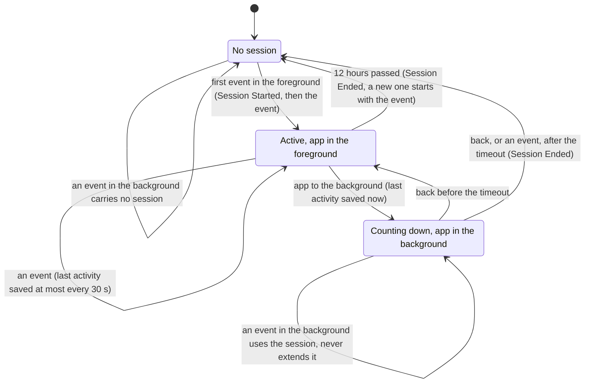
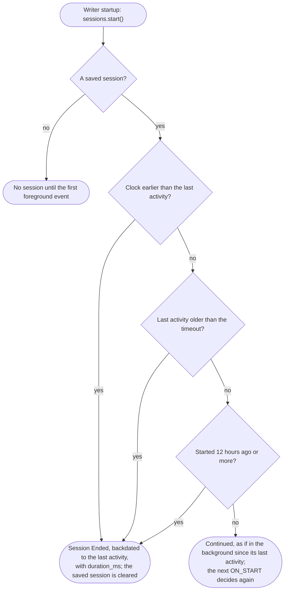
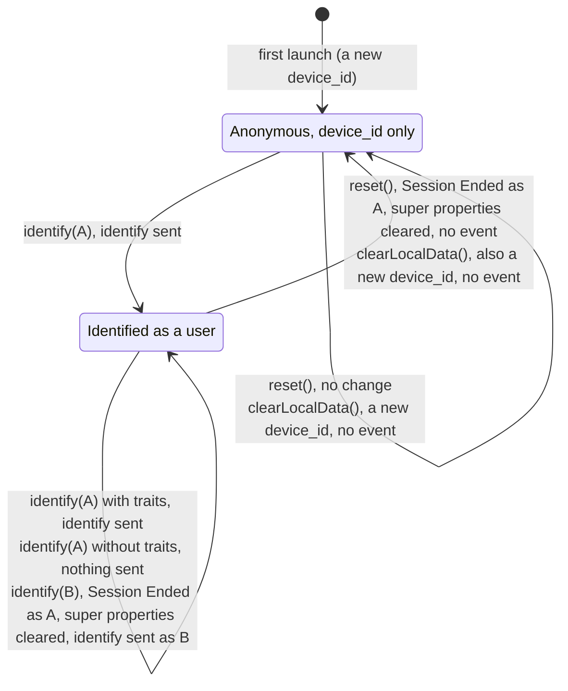
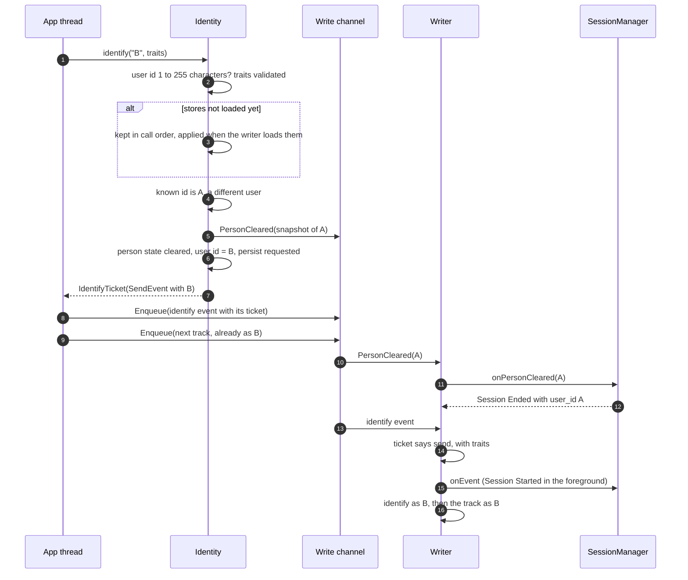
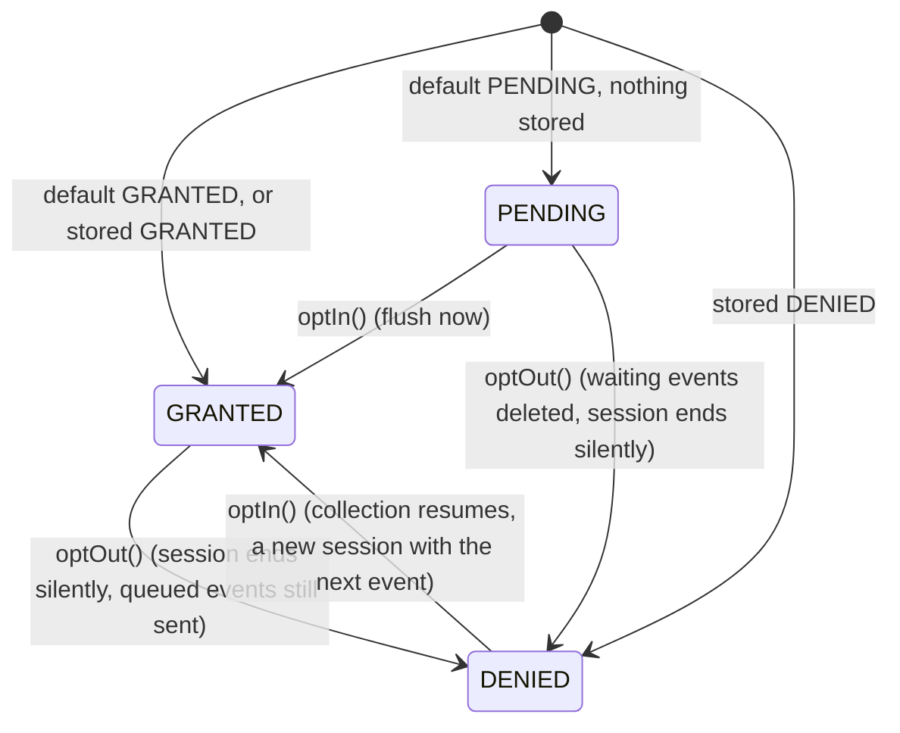
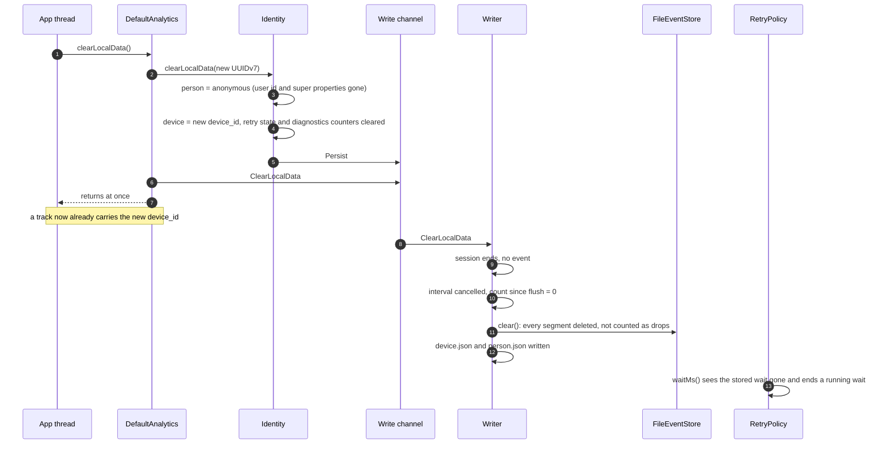

# 4. Identity, sessions and privacy

[Index](README.md) · Previous: [3. Queue, storage and upload](03-queue-and-upload.md) · Next: [5. Android](05-android.md)

## 4.1 Sessions

A session is one visit: it starts with the first event while the app is in the foreground, and ends
when the app has been in the background longer than `session.backgroundTimeoutMs` (default 5
minutes), or after 12 hours at most. `SessionManager` runs on the writer and has no timers: an end
is noticed when the app returns to the foreground, an event arrives or the process starts
(Session 1 to 6).

### 4.1a An example

| Time | What happens | Session |
|---|---|---|
| 10:00 | App opened, `Application Opened` | S1 starts: `Session Started`, then the event |
| 10:20 | App goes to the background | S1 counts down; its last activity, 10:20, is saved |
| 10:23 | Back within 5 minutes | S1 goes on |
| 10:30 | Background again | S1 counts down from 10:30 |
| 10:50 | Back after 20 minutes | `Session Ended` for S1, dated 10:30, `duration_ms` 30 minutes; S2 starts with `Application Opened` |
| 10:52 | The process is killed | S2 is saved in `person.json` |
| 10:54 | App started again | Within 5 minutes of S2's last activity: S2 goes on |

### 4.1b The states

Some calls end a session in any state:

| Call | Session |
|---|---|
| `reset()`, or `identify` with a different user | `Session Ended`, sent as the previous user; the next foreground event starts a new one |
| `optOut()`, `clearLocalData()` | Ends without an event |

### 4.1c At process start

The saved session in `person.json` is checked with the wall clock, the only clock that survives a
restart:

| Event | Timestamp | Properties | Session |
|---|---|---|---|
| `Session Started` | The session's start, right before the event that opened it | none | The new one |
| `Session Ended` | The last activity, backdated | `duration_ms` | The ended one; after a reset or user switch, with the previous `user_id` |

With `Autocapture.SESSIONS` off, session ids still go on every event; only these two events are not
created.

## 4.2 Identity

The user id and super properties live in `person.json`, the device id in `device.json`. Every call
changes memory on the calling thread at once, so a `track` right after `identify` already carries
the new id (Identity 1 to 5, Public API 9).

The device id never changes on `reset()`; only `clearLocalData()` gives a new one. Traits go with
the identify event only and are never stored. While opted out, `identify` still updates the stored
identity but sends nothing (Privacy 1).

The sequence below is a user switch. `identify` decides on your thread whether an event is due and
gives the writer that decision as a ticket with the event, so the writer never has to guess what the
identity was at the time of the call.

| Call | Stored user id | Super properties | Event | Session |
|---|---|---|---|---|
| `identify(A)` while anonymous | A | Kept | `identify` | Same |
| `identify(A)` again | A | Kept | Only with traits | Same |
| `identify(B)` while A | B | Cleared | `identify` | Ends as A; a new one starts |
| `reset()` | none | Cleared | none | Ends as the previous user |
| `register(key, value)` | Same | Added, validated at once | none | Same |
| `unregister(key)` | Same | Removed | none | Same |

## 4.3 Consent

`ConsentController` holds three states. `privacy.defaultConsent` gives the first one; with
`privacy.persistConsent` (default on) the user's stored choice wins at every start (Privacy 1, 2, 4).

| State | New events | Written to disk | Uploaded | `isOptedOut()` | Remote config fetch |
|---|---|---|---|---|---|
| `GRANTED` | Yes | Yes | Yes | `false` | Yes |
| `PENDING` | Yes | Yes | No, they wait | `true` | Yes, it carries no personal data |
| `DENIED` | No | No | Yes, what was queued with consent | `true` | Yes |

The change applies in memory at once on the calling thread; the writer then gets `ConsentChanged`
in order with the events, so an event tracked right before `optOut()` is still written. No event
records the change; one INFO line does.

## 4.4 `clearLocalData()`: forget this user

For a deletion request: everything the SDK holds about the person goes, and the device becomes a new
installation for analytics. Consent, the last version and build and the remote configuration stay,
so the user is not asked again and no false update is reported (Privacy 3).

| Cleared | Kept |
|---|---|
| `user_id`, super properties, the open session | Consent choice |
| `device_id` (a new one; sampling draws again) | Last app version and build |
| Every queued event | Remote configuration and its ETag |
| Retry wait and attempts | The configuration in code |
| `SDK Diagnostics` counters | |
