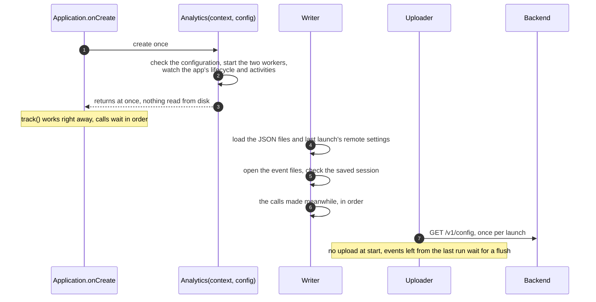
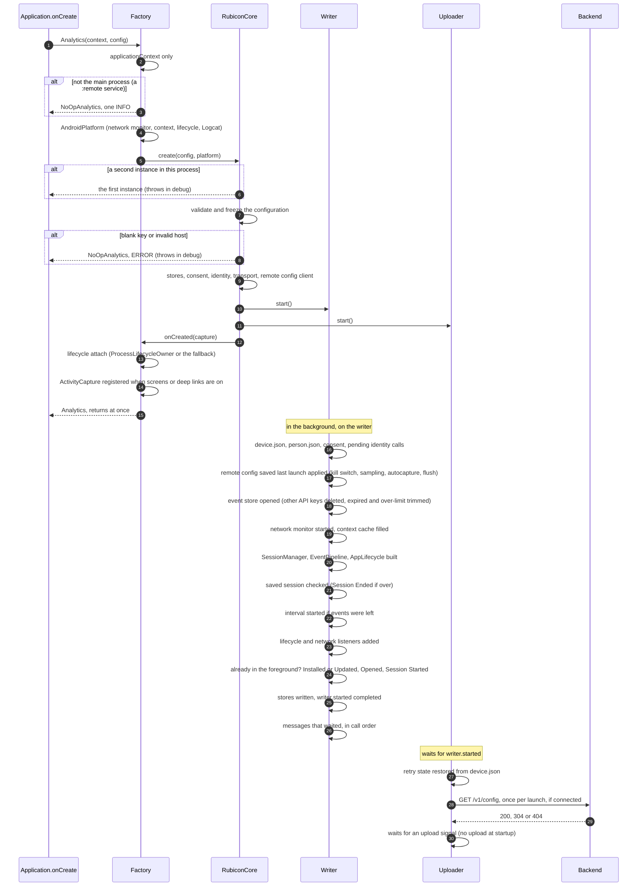
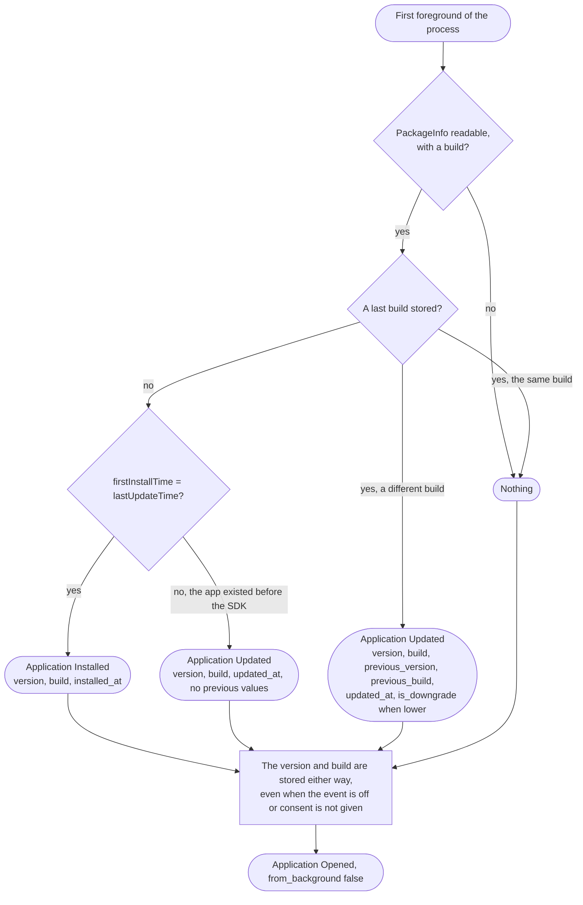
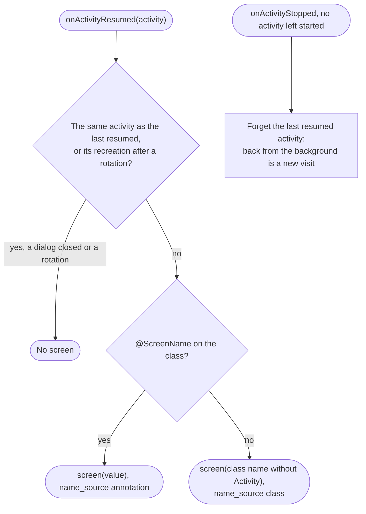
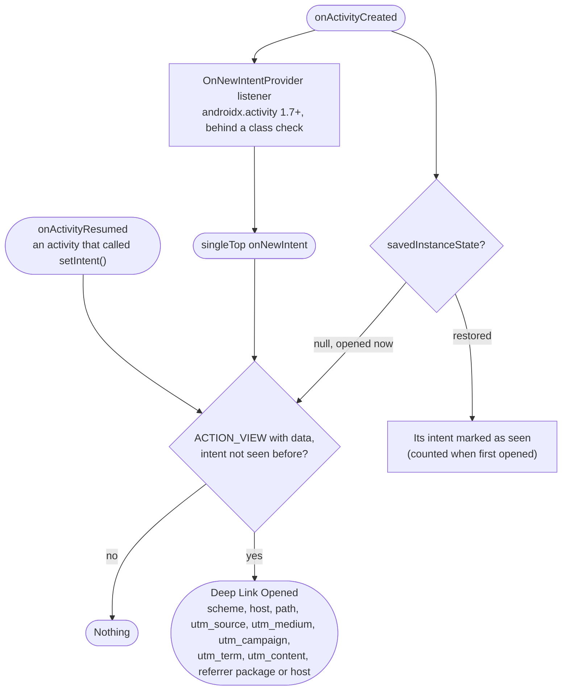
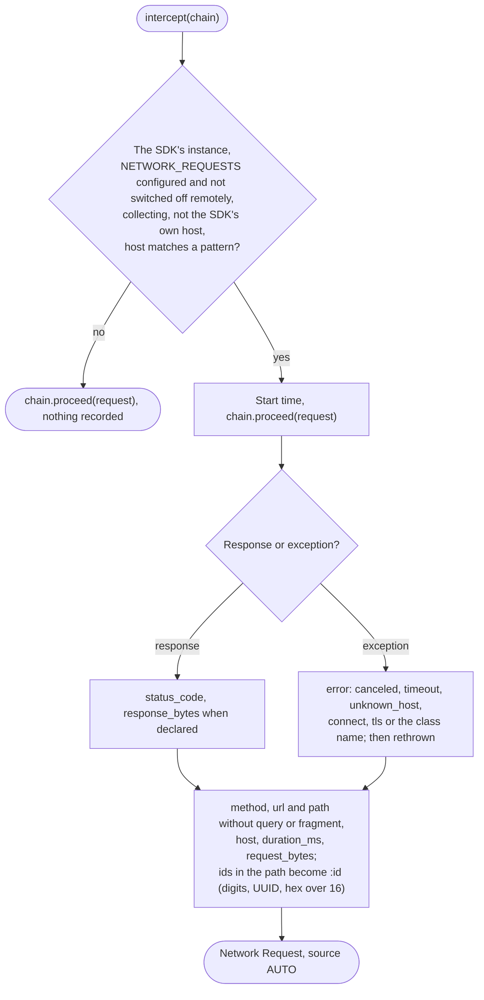
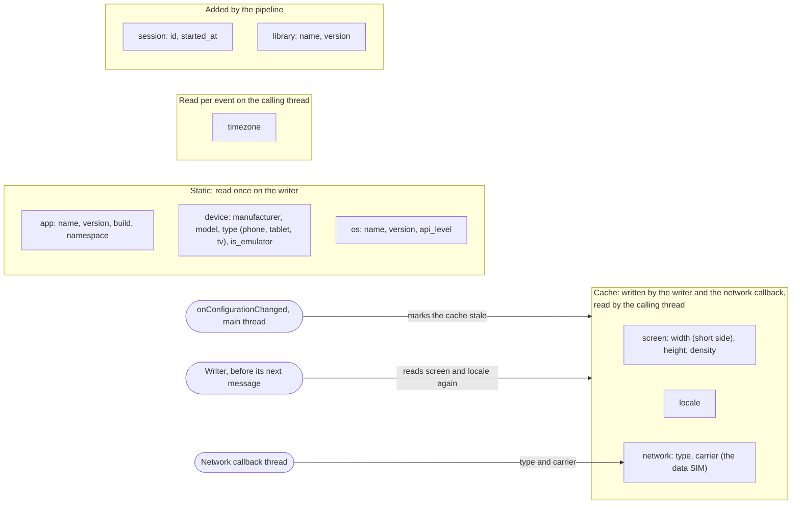
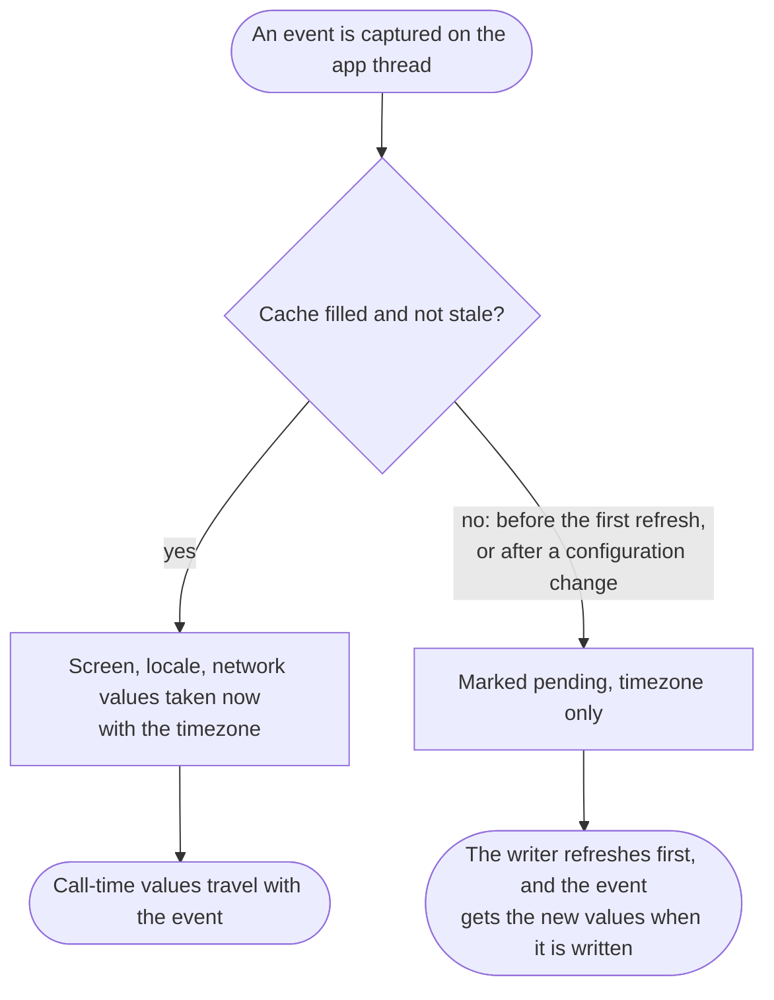
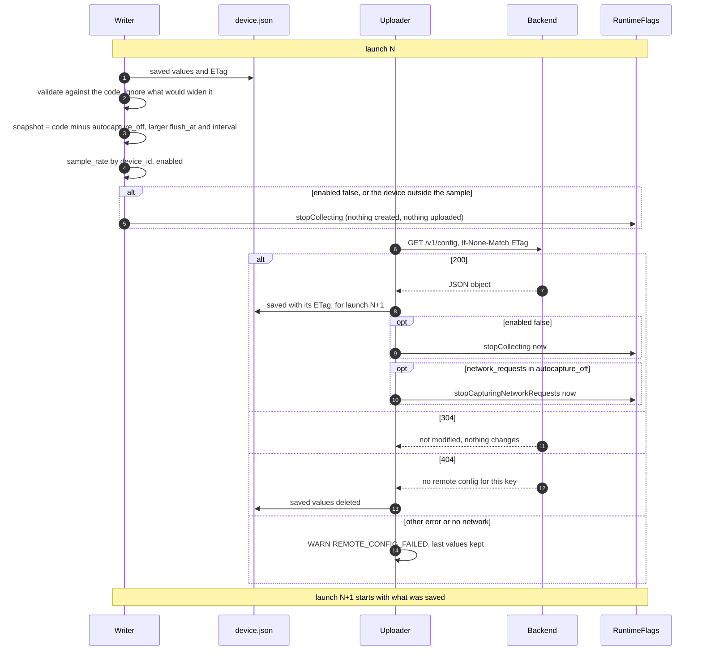
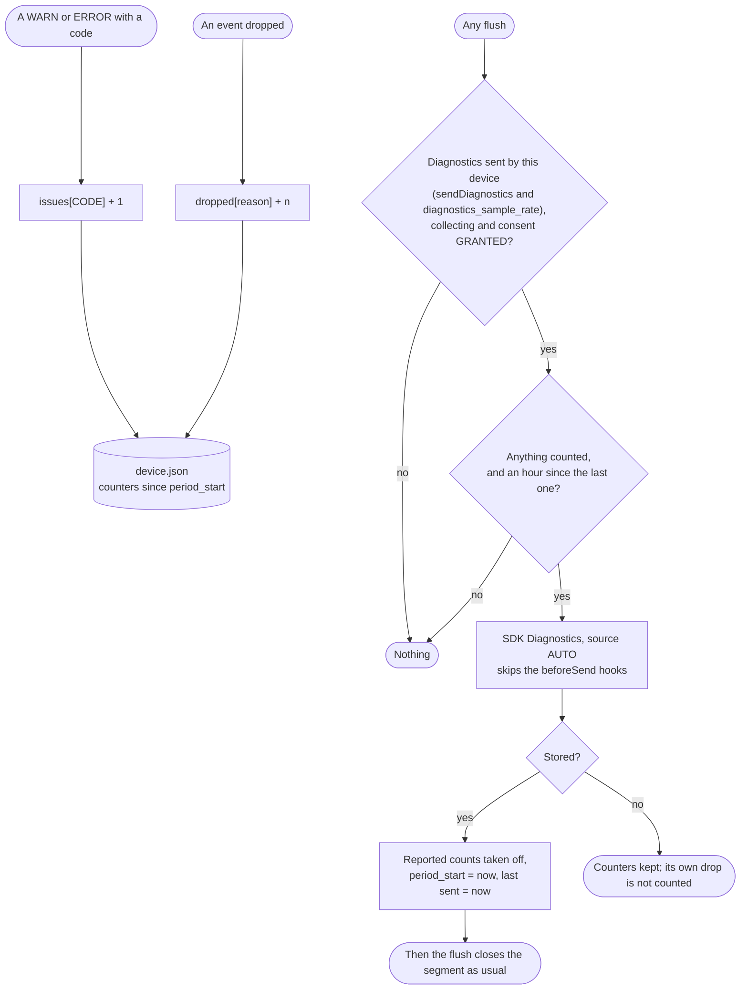

# 5. Android

[Index](README.md) · Previous: [4. Identity, sessions and privacy](04-identity-session-privacy.md)

## 5.1 Startup

`Analytics(context, config)` in `Application.onCreate`. The calling thread reads nothing from disk;
the writer loads the files first, and every call made meanwhile waits for it in call order
(Public API 1, 2; Privacy 2; Disk 2d).

### 5.1a The big picture



| If | `Analytics(context, config)` returns |
|---|---|
| Not the app's main process, for example a `:remote` service | An instance that does nothing, one INFO |
| A blank API key or an invalid host | An instance that does nothing, ERROR (throws in debug) |
| Called a second time in the process | The first instance, ERROR (throws in debug) |

### 5.1b The same, in detail



## 5.2 Installed, updated or nothing

On the first foreground of each process, `AppLifecycle` compares `PackageManager` with the last
version and build in `device.json` (Lifecycle 4). The build is the version code.



| Situation | Stored build | Installed app | Event |
|---|---|---|---|
| First install | none | build 42, installed and updated at the same time | `Application Installed` |
| An app already in use adds the SDK in an update | none | build 42, updated later than installed | `Application Updated` without previous values |
| Update from 41 to 42 | 41 | 42 | `Application Updated`, `previous_build` 41 |
| Rollback from 42 to 41 | 42 | 41 | `Application Updated`, `is_downgrade` true |
| Normal launch | 42 | 42 | none, only `Application Opened` |

Stored either way, so an opt-in or a feature switched on later never reports a false update. After
`clearLocalData()` the last build is kept for the same reason (Privacy 3).

## 5.3 Screen views and deep links

`ActivityCapture` listens to the activity callbacks on the main thread and holds activities only
weakly (Lifecycle 3, 6; Privacy 5b; non-negotiable 5).





| The user | Screen event | Deep link event |
|---|---|---|
| Opens the app on `HomeActivity` | `Home` | none |
| Opens `ProductActivity` annotated `@ScreenName("product_detail")` | `product_detail` | none |
| Rotates the phone | none | none |
| Closes a dialog over the same activity | none | none |
| Goes to the background and comes back to the same activity | `product_detail` again | none |
| Taps `shop://product/42?utm_source=mail&token=x` | the opened activity's screen | `Deep Link Opened`: scheme, host, path, `utm_source`; never `token` |

Never another query parameter and never the fragment: the list is fixed, because an extensible one
invites tokens. A token in a path is the app's to mask in `beforeSend`.

## 5.4 Network request capture

`RubiconNetworkInterceptor` is added by the app to its own `OkHttpClient`. It never changes the
request or the response and never throws anything the call did not throw (Lifecycle 1, 6; Privacy
5c; D13).



| Pattern | Matches | Does not match |
|---|---|---|
| `api.shop.com` | `api.shop.com`, `API.shop.com` | `x.api.shop.com` |
| `*.shop.com` | `api.shop.com`, `a.b.shop.com` | `shop.com` |
| `*.com`, `https://x.com`, `x.com/path` | invalid: throws in debug, else WARN and ignored | |

Headers, bodies, query strings and fragments are never read, only the bodies' declared lengths.

## 5.5 Context collection

Every event carries `context`. Each value is read where it is cheapest and safest; a value that
cannot be read is left out, and a field in `context.disabledFields` is never read (Context 1 to 3, 6).





Without a network callback (no permission, or registration failed) the writer reads the network type
and carrier at most once a minute. Without `ACCESS_NETWORK_STATE` the SDK assumes it is connected.

## 5.6 Remote configuration

Remote values can only restrict what the code allows. One fetch per launch, in the background; the
saved values apply at the next launch, except two switches that apply at once (Configuration 1).



| Key | Effect | When |
|---|---|---|
| `enabled: false` | The kill switch: nothing collected or uploaded | At once and at the next launch |
| `enabled: true` | Changes nothing; turning back on waits for the next launch | Next launch |
| `autocapture_off: ["network_requests"]` | The interceptor stops | At once |
| `autocapture_off: [other types]` | Those automatic events stop | Next launch |
| `flush_at`, `flush_interval_ms` | Only larger than the code's values | Next launch |
| `sample_rate` | The share of devices that collect, by `device_id` | Next launch |
| `diagnostics_sample_rate` | The share of devices that send `SDK Diagnostics` | Next launch |
| An unknown key | Ignored at DEBUG, for newer SDKs | |
| A value that is invalid or would widen the code | Ignored, WARN `REMOTE_CONFIG_INVALID_VALUE` | |

The fetch runs also while consent is pending or the user opted out: it carries no personal data
(Privacy 4).

## 5.7 SDK Diagnostics

The SDK's health as counters, without text, values or stack traces. Every WARN and ERROR code and
every drop is counted in `device.json`; the counters go out as one event at most once an hour
(Logging 5).



```json
{
  "event": "SDK Diagnostics",
  "properties": {
    "period_start": "2026-10-05T08:00:00.000Z",
    "dropped": { "total": 1240, "before_send": 3, "expired": 37, "queue_full": 1200 },
    "issues": { "HOST_BLOCKED": 12, "PROPERTY_DROPPED": 4 }
  }
}
```

| Drop reason | Where |
|---|---|
| `backpressure` | The write channel was full (2.1) |
| `before_send` | A hook dropped, threw or broke the rules (2.2) |
| `oversize` | Over 32 KB after the hooks (2.2) |
| `storage_error` | The append to disk failed |
| `queue_full` | Over 1000 pending, trimmed to 900 (3.2) |
| `expired` | Older than 3 days (3.2) |
| `corrupt` | An unreadable line or segment (3.2) |
| `api_key_changed` | Events of another key at startup (3.2) |
| `rejected` | 400, 422 or another 4xx (3.3) |
| `retry_exhausted` | A poison batch (3.4) |
